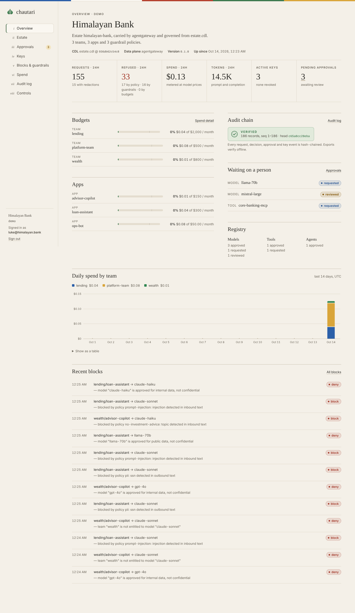

<p align="center">
  
</p>

<h1 align="center">chautari</h1>

<p align="center"><b>The open AI control plane.</b><br>
Describe your AI estate in one file. Generate the stack that runs it. Govern every request that crosses it.</p>

---

## Why Chautari

Organizations adopting AI need a way to govern their entire AI estate: models, tools, agents, policies, and budgets. Chautari provides this as open-source infrastructure you can audit, extend, and run yourself.

**Core principles:**

- **Open source, Apache 2.0.** Full transparency, no vendor lock-in
- **Built on proven foundations.** Traffic via [agentgateway](https://agentgateway.dev) (Linux Foundation), policy via [OPA](https://www.openpolicyagent.org), telemetry via [OpenTelemetry](https://opentelemetry.io)
- **Infrastructure as code.** Your AI estate lives in a `.cdl` file—version-controlled, auditable, reproducible
- **Evidence-based compliance.** Controls reports reference the hash-chained audit log with verifiable evidence

## 60-second quickstart

You need Docker. Nothing here calls a real model provider.

```sh
git clone https://github.com/lukelittle/chautari && cd chautari
docker compose up
```

Open **http://localhost:8080** and sign in with the token `chautari-demo`.
The demo estate, *Himalayan Bank* ([`examples/himalayan-bank.cdl`](examples/himalayan-bank.cdl)),
is already busy: three teams, an offline mock provider behind agentgateway,
Postgres, OpenTelemetry, and a traffic generator sending a realistic mix of
everyday prompts, leaked SSNs, prompt injections and requests for models
nobody approved.



Talk to it like any OpenAI-compatible endpoint:

```sh
# Mint a key for the loan-assistant app (shown once).
KEY=$(curl -s localhost:8080/api/keys -H "Authorization: Bearer chautari-demo" \
  -H "X-Chautari-Actor: you@example.com" -d '{"app":"loan-assistant"}' | jq -r .secret)

# Allowed, with the SSN and email redacted before the model sees them.
curl -s localhost:8080/v1/chat/completions -H "Authorization: Bearer $KEY" \
  -d '{"model":"claude-sonnet","messages":[{"role":"user","content":"Summarise the file for jane@example.com, SSN 123-45-6789"}]}'

# Denied by policy, with every reason: llama-70b is still awaiting model-risk
# approval, lending isn't entitled to it, and it isn't cleared for the
# confidential data this app handles.
curl -s localhost:8080/v1/chat/completions -H "Authorization: Bearer $KEY" \
  -d '{"model":"llama-70b","messages":[{"role":"user","content":"hi"}]}'
```

Any OpenAI SDK works: point `base_url` at `http://localhost:8080/v1`.

## Your own estate

```sh
go install github.com/lukelittle/chautari/cmd/chautari@latest

chautari init                         # a starter estate.cdl
chautari validate estate.cdl
chautari generate estate.cdl -o ./ai-estate
```

```cdl
model claude-sonnet { provider bedrock, approved true, data-class internal }
tool jira-mcp { endpoint "http://jira-mcp:8080/mcp", scope read, owners [platform-team] }
policy pii { redact inbound, block outbound ssn, card }
team lending { models [claude-sonnet], budget 2000 usd/month, tools [jira-mcp] }
```

`chautari generate` writes:

| Path | What |
|---|---|
| `gateway/gateway.yaml` | agentgateway v1.6.0 config, validated against its upstream schema in our tests |
| `docker-compose.yml`, `.env.example` | the whole stack, locally |
| `helm/<estate>/` | Kubernetes chart: control plane with agentgateway as a sidecar |
| `terraform/aws/` | ECS Fargate, RDS Postgres, ALB, Secrets Manager, IAM for Bedrock |
| `otel/collector.yaml` | OpenTelemetry Collector |
| `policy/` | the Rego bundle and data, so auditors can `opa eval` exactly what runs |
| `CONTROLS.md` | the controls-mapping report for this estate |

Re-running it is idempotent: unchanged files aren't touched, and files you've
edited are left alone (and reported) unless you pass `--force`.

The language is documented in [docs/CDL.md](docs/CDL.md).

## What the control plane does

Every request enters through the **checkpoint** (`/v1/chat/completions`,
`/mcp`, `/a2a/<agent>`), and every one goes through the same steps:

1. **Authenticate** the app's key. Keys are stored only as SHA-256 hashes.
2. **Decide with OPA.** The model, tool or agent must be approved, the team
   entitled, and both cleared for the request's data class
   (`public < internal < confidential < restricted`).
3. **Check budgets and rate limits** per team, app and key.
4. **Run guardrails on the prompt:** PII (with Luhn and mod-97 checks so dates
   aren't "SSNs"), prompt injection, blocked topics, or Amazon Bedrock
   Guardrails. Each can redact, block or flag.
5. **Forward to the data plane**, which holds the provider credentials.
6. **Run guardrails on the response.** Streams are buffered when an outbound
   rule applies, because a guardrail that runs after the bytes have left is
   not a guardrail.
7. **Meter and audit.** Usage × price → spend. One record lands in the
   hash-chained log, holding a digest of the prompt and never the prompt
   itself.

Around that sit:

- **A registry** with an approval workflow: requested → reviewed → approved →
  retired. Nobody approves their own request. Retiring is a kill switch that
  pulls the model out of policy and the gateway config at once.
- **An append-only audit log.** Postgres refuses `UPDATE`, `DELETE` and
  `TRUNCATE`. Run `chautari audit verify export.jsonl` to check any export
  offline.
- **A controls report** mapping all of it to NIST AI RMF 1.0 and SR 11-7, with
  live evidence from the log.
- **An admin UI**: estate inventory, spend, policy blocks and pending approvals.

The design lives in [ARCHITECTURE.md](ARCHITECTURE.md).

## Development

```sh
make test       # the whole suite, offline, against the mock provider
make test-pg    # plus Postgres integration tests (throwaway container)
make e2e        # through a real agentgateway binary (AGENTGATEWAY=/path/to/it)
make build      # bin/chautari, bin/mock-llm
```

The test suite needs no network and no API keys. It covers:

- the CDL compiler, with a fuzzer;
- every policy and guardrail path;
- end-to-end checkpoint requests, streaming included;
- audit tamper detection;
- generator idempotency;
- every rendered gateway config, validated against agentgateway's JSON schema;
- the Helm chart and Terraform, checked with `helm lint` and
  `terraform validate` whenever those tools are installed.

## Status

v0.1. Everything described above is implemented and tested. The suite runs
offline, against Postgres, and end to end through a real agentgateway v1.6.0
binary (`make e2e`). Two adversarial reviews (security and correctness) have
been run against the code, and every finding is fixed with a regression test.
Before production, know these limits:

- **Use per-person admin tokens** (`CHAUTARI_ADMIN_TOKENS`). With one shared
  token, approvers name themselves and separation of duties is advisory. The
  controls report says so. OIDC is next.
- **Rate limits and in-flight budget reservations are per replica.** Spend
  itself is shared through Postgres; ARCHITECTURE.md §9 gives the exact bound.
- **The Terraform and Helm chart are validated, not yet battle-tested.** They
  pass `helm lint`, `helm template` and `terraform validate`. Read them before
  you `apply`.

Issues and pull requests are welcome.

## License

[Apache 2.0](LICENSE). All source files include license headers, verified by `go run ./tools/licensecheck`.
